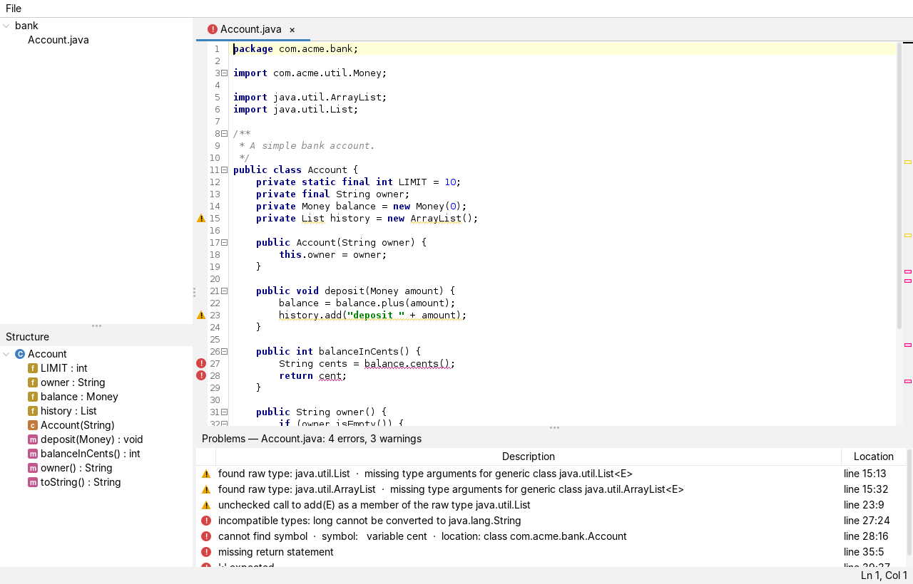
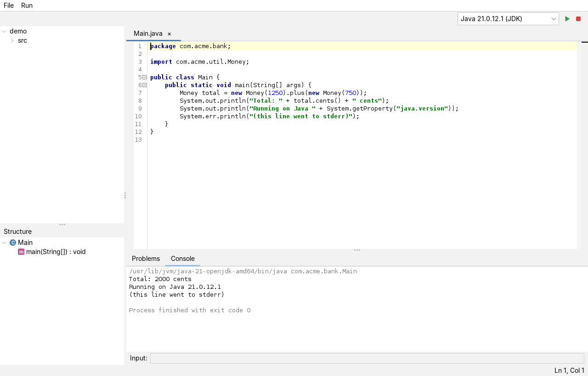

# JEditor

A straightforward Java editor, written entirely in Java 21: file viewer on the left, editor in the
middle, and live compile-error checking as you type.



## Features

- **File viewer** — tree of the opened folder; double-click (or Enter) opens a file in a tab.
  *File → Open Folder…* switches project, *File → Close Folder* closes it along with its tabs.
- **Editor** — Java syntax colouring, line numbers, bracket matching, mark-occurrences,
  auto-indent, undo/redo, tabs with unsaved-changes marker.
- **Compile errors** — every Java file is compiled when opened and again ~0.4 s after each edit
  (in the background, from the unsaved editor content). Problems are shown the way classic IDEs do:
  - squiggly underline on the offending code, with the compiler message as tooltip,
  - error/warning icon in the gutter and a mark in the overview strip beside the scrollbar,
  - a **Problems** table at the bottom; double-click a row to jump to it,
  - an error badge on the tab.
- **Code blocks** — `[-]`/`[+]` fold markers show where each class, method and comment starts and
  ends; the **Structure** panel outlines types and members (click to navigate); the status bar shows
  the block the caret is in and the lines it spans.

- **Run** — the ▶ button (Shift+F10) compiles the current file and runs its `main` method on the
  Java runtime chosen in the toolbar; output appears in the **Console** tab, which also accepts
  input. Add any installed JRE or JDK (Java 8+) under *Run → Java Runtimes…*.



**How it all works, in a few pages: [docs/HOW_IT_WORKS.md](docs/HOW_IT_WORKS.md).**

## Build and run

Requires a **JDK 21+** (a JDK, not a JRE: the editor uses the JDK's own compiler) and Maven.

```bash
mvn clean package
```

```bash
java -jar jeditor-ui/target/jeditor.jar /path/to/folder-or-file
```

Without an argument the current directory is opened.

## Project structure

| Module | What it is |
| --- | --- |
| `jeditor-compiler` | The compiler component. No UI, no third-party dependencies. |
| `jeditor-ui` | The Swing application. |

### `jeditor-compiler`

Built on `javac` itself through the standard `javax.tools` API and the Compiler Tree API, so the
diagnostics are exactly those of the real compiler, for the full Java 21 language.

```java
AnalysisResult result = new JavaSourceAnalyzer().analyze(path, sourceText);
result.diagnostics();  // severity, message, line, column, start/end offsets
result.structure();    // tree of types/methods/fields with their source ranges
```

- Source is analysed from memory; nothing is written to disk (no class files are generated).
- Syntax, type and flow errors are reported together in one pass.
- The `run` sub-package finds Java installations (`JavaRuntime`, `RuntimeRegistry`), compiles a
  program for a chosen runtime (`ProgramBuilder`) and starts it (`JavaLauncher`).
- `ProjectLayout` works out where other classes live: the source root implied by the `package`
  declaration, and for Maven projects `src/main/java`, `src/test/java`, `target/classes` of the
  module and its sibling modules, plus jars in `target/dependency` or `lib`.

### `jeditor-ui`

Uses [RSyntaxTextArea](https://github.com/bobbylight/RSyntaxTextArea) for the text component
(highlighting, folding, squiggles) and [FlatLaf](https://www.formdev.com/flatlaf/) for the look and
feel. Both are pure Java.

## Third-party libraries in edited projects

Maven dependencies are not resolved automatically. To let the editor see a project's libraries
(otherwise their imports are reported as errors), copy them once into `target/dependency`:

```bash
mvn dependency:copy-dependencies
```

## Tests

```bash
mvn test
```

The compiler module carries the bulk of the tests: diagnostics and their exact positions, warnings,
cross-file resolution, project layout detection, structure extraction, runtime detection, and
building and actually running programs.
